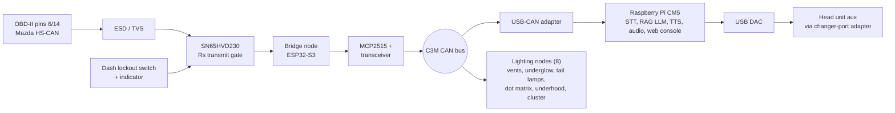

# RX-8 C³M: Central Custom Control Module

A CAN-connected, voice-driven control system for a 2004 Mazda RX-8 show-car
build. A Raspberry Pi CM5 is the hub, ESP32 modules are the satellites, and a
small local LLM answers questions about the car using the factory manuals and
parts catalog.

> **Status:** the voice and knowledge software is built and tested on a PC and
> on the CM5 on the bench. Nothing has run on the car yet: the CAN bridge,
> lighting modules and everything that touches the vehicle are still design or
> stub firmware. Anything unverified is marked as such.

## Planned features

The full list, with node, safety class and status for each function, is in
[`docs/functions.md`](docs/functions.md). In short:

- **A car that knows itself.** A local retrieval-augmented model (Qwen2.5-0.5B
  with a LoRA that teaches behavior only) answers "what's my master cylinder
  part number?" from the car's own manuals. Part numbers, DTC meanings and specs
  come from SQLite tables and are answered by code, never generated.
- **Diagnostics announcements.** Detect the check-engine light on the CAN bus,
  request the stored and pending codes over OBD-II, and announce them in plain
  language.
- **Voice and audio.** CPU-only speech-to-text, LLM and text-to-speech on the
  CM5, mixed through the factory head unit's aux input, with music fading down
  and up around voice prompts.
- **Lighting.** Eight ESP32 lighting nodes: side-vent image displays,
  underglow, tail lamps, a center dot-matrix lamp, underhood animation, and a
  cluster backlight, all with plain lamp function that survives a software
  failure.
- **Show-mode control.** Each custom function can be turned on and off
  individually from a password-protected web console. Legal-critical lamp
  functions additionally need a physical switch and a parked state.
- **More over time:** a HUD, a passenger terminal, a key-fob subsystem, door
  audio, and later LIDAR and cameras on separate compute.

## Architecture

The Mazda bus and the private C3M bus never touch electrically. The bridge is
the only crossing point. The ABS valve system is separate from CAN entirely.
Details are in [`docs/architecture.md`](docs/architecture.md).

## Design principles

1. **Exact facts come from tables, not model memory.** Part numbers and DTC
   meanings live in SQLite. The model turns a question into a lookup and
   phrases the result when needed.
2. **Transmit on the Mazda bus needs two independent yeses.** A dash lockout
   switch and a firmware signal must both agree before the CAN transceiver can
   drive the bus. By default only whitelisted read-only diagnostic requests can
   leave. A separate programming mode for future ECM work is deferred and has
   its own rules.
3. **The model never touches a bus.** Voice picks a named command from a
   registry. Code validates it and sends a fixed message on the private bus.
4. **Fail to plain.** If the link to the hub dies, lighting modules revert to
   ordinary stop, turn and reverse operation.
5. **Send commands, not pixels.** CAN carries modes and sync ticks. Animations
   render locally on each lamp module.
6. **Show mode is per function and enforced on each node.** Legal-critical
   lamps need a physical switch and a parked state.
7. **Leave the factory modules alone.** No changes to the PCM, BCM, ABS module
   or steering modules. The stated exceptions (airbag module removal, brake-line
   valves, future ECM work) are in [`SAFETY.md`](SAFETY.md).

## Repository layout

| Path | Contents |
|---|---|
| `docs/` | Architecture, function list, decision log, CAN tap, voice/audio, lighting and legal notes, BOM |
| `hardware/` | Schematic notes and BOMs |
| `firmware/can_tap/` | ESP32 CAN bridge node (PlatformIO, C++). Stub only so far |
| `firmware/lamp_module/` | Lighting node firmware (planned) |
| `software/rag/` | Retrieval, answer logic, training-data and eval scripts |
| `software/service/` | The voice service, owner web console, and Pi deploy script |
| `software/tools/` | Database build, OCR and verification tooling, DTC extractor, CM5 benchmarks |
| `tests/` | Test notes |
| `data/` | Empty on purpose. Manuals and derived data are not redistributed |

## What works today

Tested on a PC and on the CM5 on the bench (not on the car):

- **Knowledge base:** a SQLite database built from the factory manuals and
  parts catalog, with about 1,700 hand-verified part rows, DTC records, service
  specs, and a table of this car's own figures. Retrieval passes its 25-question
  check set.
- **Answer logic:** DTCs, part numbers and specs are answered by code. The model
  handles narrative and procedures only. A part number that is not in the
  database is refused, never invented.
- **Model:** Qwen2.5-0.5B-Instruct plus a behavior-only LoRA, Q4_0 under
  llama.cpp. On the CM5 a retrieved-context question takes about 4.5 s, and
  code-path answers about 0.03 s.
- **Owner web console:** password-protected editing of parts, a prewritten-reply
  table, and an allow-listed command box. Built and tested on the PC.
- **DTC extractor:** pulls per-DTC records out of a factory manual with a text
  layer.
- **Benchmarks on the CM5:** whisper.cpp, Piper and the embedding step.

Not yet running: boot-time services, speech input and output on the Pi, any CAN
traffic, any lighting node, any function on the car. You supply your own copies
of the manuals. See [`software/README.md`](software/README.md).

## Roadmap

- [x] Architecture and design decisions written down
- [x] DTC extractor prototype
- [x] Triage the manual set (native text versus scans)
- [x] OCR the parts catalog and build the parts table (verification ongoing)
- [x] RAG baseline, evaluation sets, LoRA fine-tune
- [x] Owner web console (PC)
- [x] Function list with safety classes ([`docs/functions.md`](docs/functions.md))
- [ ] Final database pass, then deploy to the CM5
- [ ] Boot-time services; STT, TTS and audio ducking pipeline
- [ ] CAN bridge bench build, listen-only logger, find the MIL flag on the bus
- [ ] Gated OBD-II DTC read (Mode 03 and 07)
- [ ] C3M CAN bus and SocketCAN on the CM5
- [ ] Show-mode registry in the web console
- [ ] Lighting nodes, starting with the tail lamps
- [ ] HUD, passenger terminal and the remaining functions

## Safety and legal

This is for a show car that is not driven on public roads. Read
[`SAFETY.md`](SAFETY.md) and [`docs/lighting.md`](docs/lighting.md) before
building anything similar.

## License

MIT. See [`LICENSE`](LICENSE). Factory manuals and parts catalogs belong to
their owners and are not included.
