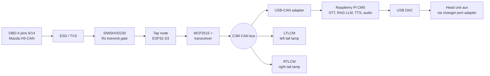

# RX-8 C³M: Central Custom Control Module

A CAN-connected, voice-driven control system for a 2004 Mazda RX-8 show-car
build. A Raspberry Pi CM5 is the hub, ESP32 modules are the satellites, and a
small local LLM answers questions about the car using the factory manuals.

> **Status: design phase.** The architecture and decisions are documented, one
> tool has been tested against real data (the DTC extractor), and nothing has
> been run on the car yet. Anything unverified is marked as such.

## Planned features

- **Diagnostics announcements.** Detect the check-engine light on the CAN bus,
  request the stored and pending codes over OBD-II, and announce them in plain
  language.
- **A car that knows itself.** A local retrieval-augmented model (Qwen2.5-0.5B)
  that answers "what's my master cylinder part number?" from the car's own
  manuals, with exact data pulled from tables, not generated by the model.
- **Voice and audio.** CPU-only speech-to-text, LLM, and text-to-speech on the
  CM5, mixed through the factory head unit's aux input, with music fading down
  and up around voice prompts.
- **Lighting modules.** Per-lamp ESP32 modules driving addressable LED arrays
  in the tail lamps, with plain lamp function that survives a software failure.

## Architecture

The Mazda bus and the private C3M bus never touch electrically. Details are in
[`docs/architecture.md`](docs/architecture.md).

## Design principles

1. **Exact facts come from tables, not model memory.** Part numbers and DTC
   meanings live in SQLite. The model turns a question into a lookup and
   phrases the result.
2. **Transmit needs two independent yeses.** A dash keyswitch and a firmware
   signal must both agree before the CAN transceiver can drive the bus.
3. **Fail to plain.** If the link to the hub dies, lighting modules revert to
   ordinary stop, turn, and reverse operation.
4. **Send commands, not pixels.** CAN carries modes and sync ticks. Animations
   render locally on each lamp module.
5. **Leave the factory modules alone.** The only transmissions are a short
   whitelist of read-only diagnostic requests.

## Repository layout

| Path | Contents |
|---|---|
| `docs/` | Architecture, decision log, CAN tap, voice/audio, lighting and legal notes, BOM |
| `hardware/` | Schematic notes and BOMs |
| `firmware/can_tap/` | ESP32-S3 CAN tap node (PlatformIO, C++). Stub only so far |
| `firmware/lamp_module/` | Tail lamp module firmware (planned) |
| `software/tools/` | Data tooling, including the DTC extractor |
| `data/` | Empty on purpose. Manuals and derived data are not redistributed |

## What works today

`software/tools/extract_dtcs.py` pulls per-DTC records (code, title, detection
logic, causes) out of a factory engine-control manual that has a text layer. In
testing against the real PDF it extracted 111 DTCs with no missing cause lists.
You supply your own copy of the manual. See
[`software/README.md`](software/README.md).

## Roadmap

- [x] Architecture and design decisions written down
- [x] DTC extractor prototype
- [ ] Triage the manual set (native text versus scans)
- [ ] OCR the parts catalog and build the parts table
- [ ] CAN tap bench build, listen-only logger, find the MIL flag on the bus
- [ ] Gated OBD-II DTC read (Mode 03 and 07)
- [ ] C3M CAN bus and SocketCAN on the CM5
- [ ] RAG baseline, evaluation set, then LoRA fine-tune
- [ ] STT, TTS, and audio ducking pipeline
- [ ] Tail lamp modules

## Safety and legal

This is for a show car that is not driven on public roads. Read
[`SAFETY.md`](SAFETY.md) and [`docs/lighting.md`](docs/lighting.md) before
building anything similar.

## License

MIT. See [`LICENSE`](LICENSE). Factory manuals and parts catalogs belong to
their owners and are not included.
